# Lab A: Risk-Based Conditional Access with Named Locations

**Microsoft Entra ID | Conditional Access | Identity Protection**
Built October 12, 2026 by Samuel Orji Jr as hands-on preparation for the SC-300 (Microsoft Identity and Access Administrator) exam.

---

## Overview

I built a risk-based Conditional Access policy in Microsoft Entra ID and proved it works in both directions. It applies when a sign-in is risky, and it correctly stays out of the way when the sign-in is clean. The proof comes from the What If tool and from a real sign-in log, not only from configuration screenshots.

**Scenario:** A Marketing Analyst signing in from the trusted office network must complete MFA and reauthenticate every hour, but only when Identity Protection rates the sign-in as medium or high risk.

### Environment

| Item | Detail |
|---|---|
| Tenant | Lab tenant with Microsoft Entra ID P2 |
| Test user | Franklin Clinton, Marketing Analyst, Member account created for this lab |
| Admin account | Kept out of policy scope to avoid any lockout risk |
| Licensing | One Entra ID P2 seat, moved to the test user for the lab |

### Skills demonstrated

- Named locations and trusted network design
- User creation, usage location, and license assignment
- Conditional Access assignments, conditions, grant controls, and session controls
- Sign-in risk conditions (Identity Protection integration)
- Safe rollout using Report-only mode and the What If tool
- MFA registration and Microsoft Authenticator setup
- Troubleshooting from sign-in logs and Conditional Access policy details

---

## Policy design

**Policy name:** `LabA - Require MFA for Franklin from Trusted Location`

Every condition must match for the policy to apply (AND logic).

| Setting | Value | Why |
|---|---|---|
| Users | Franklin Clinton only | Scoped test user, admin never in scope |
| Target resources | All resources (formerly All cloud apps) | Covers every app the user opens |
| Network | Include: Trusted Office IP (named location, single /32 address) | Guarantees the policy can fire from the test machine |
| Sign-in risk | Medium and High | Ties the policy to Identity Protection risk signals |
| Grant control | Require multifactor authentication | Step-up verification on a risky sign-in |
| Session control | Sign-in frequency: every 1 hour | Forces periodic reauthentication |
| State | Report-only first, then On | Test impact before enforcing |

> **Production note:** In a real environment the network logic usually runs the other way. You include any network and exclude trusted locations, so MFA only hits sign-ins from outside the office. This lab includes the trusted location on purpose so the policy could be tested from one machine.

---

## Step-by-step build

### 1. Created a trusted named location
Conditional Access > Named locations > IP ranges location. Named it "Trusted Office IP," added my public IPv4 address as a /32, and checked **Mark as trusted location**. I turned my VPN off first so Entra would see my real egress IP.

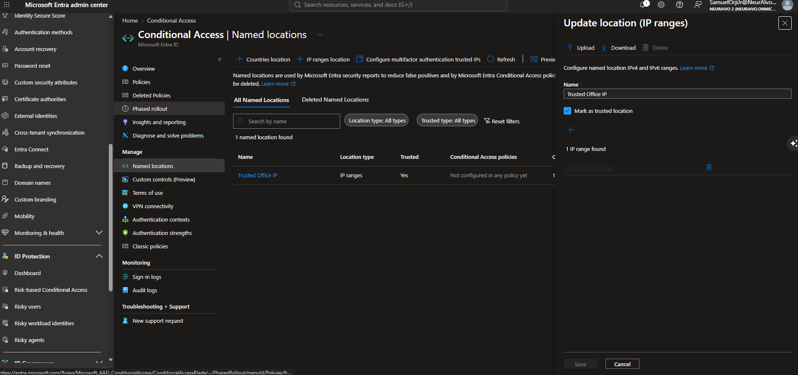

### 2. Created a dedicated test user
Entra ID > Users > New user. Franklin Clinton, Member, Marketing Analyst, usage location United States, no roles and no groups. I moved the tenant's single Entra ID P2 seat to him instead of buying a second license.

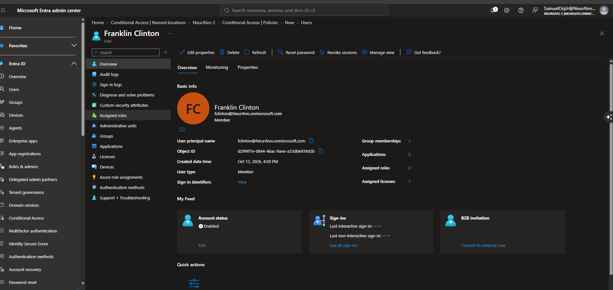

### 3. Built the policy assignments
New Conditional Access policy targeting Franklin only, All resources, and the Network condition including Trusted Office IP.

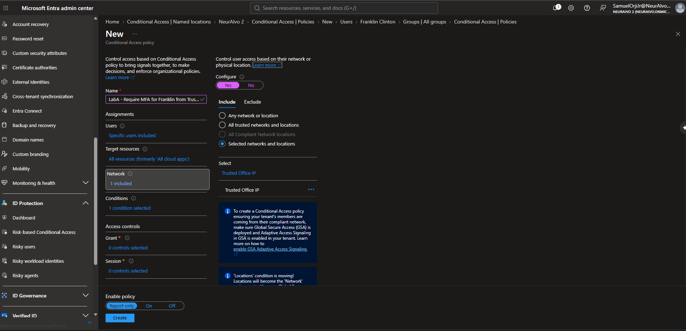

### 4. Set grant and session controls
Grant access with **Require multifactor authentication**. Session control set to **Sign-in frequency**, periodic reauthentication every 1 hour.

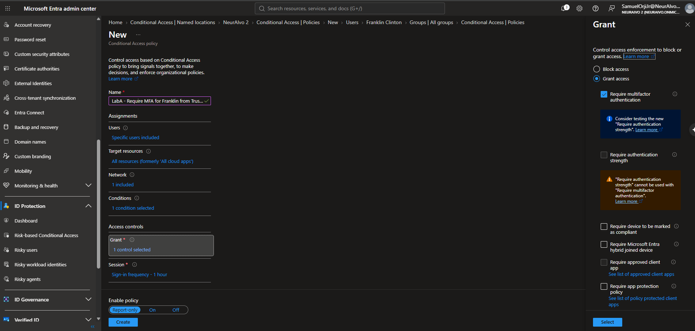
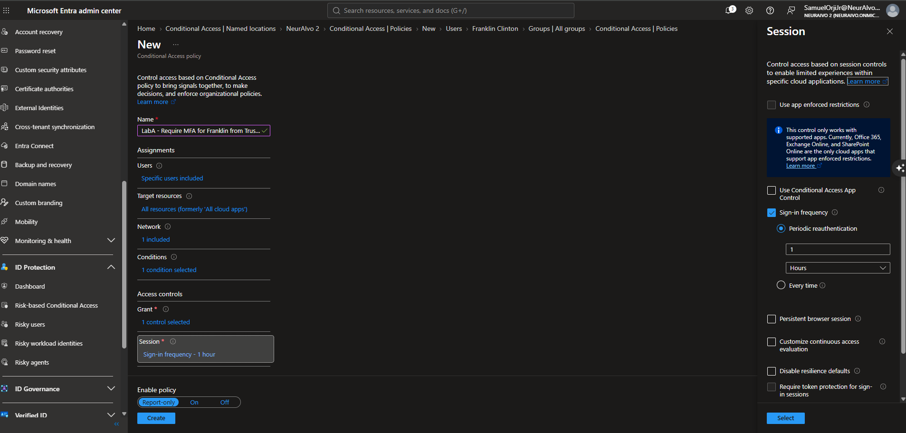

### 5. Added the sign-in risk condition
Conditions > Sign-in risk > Medium and High. Conditions now read "2 conditions selected" (Network and Sign-in risk).

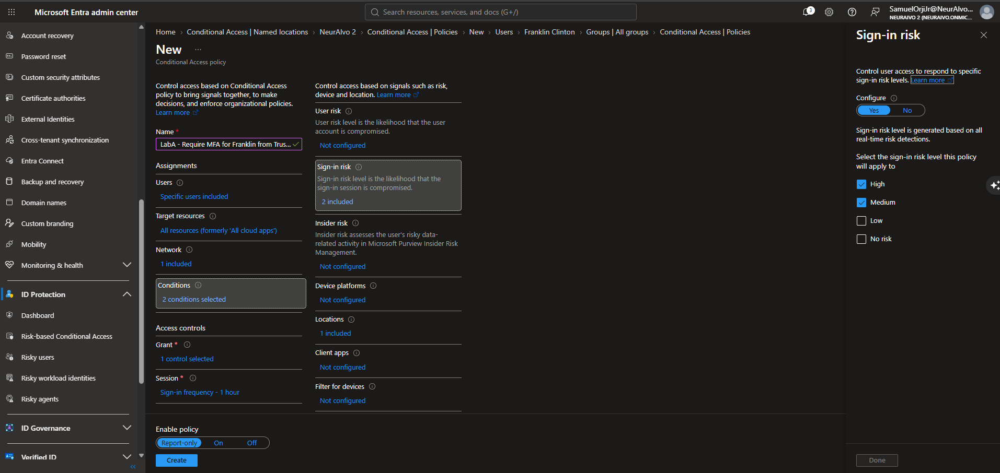

### 6. Created in Report-only and tested with What If
I ran two simulations with the same user, app, and IP, changing only the sign-in risk. At medium risk, the policy appeared under "Policies that will apply." At no risk, zero policies applied.

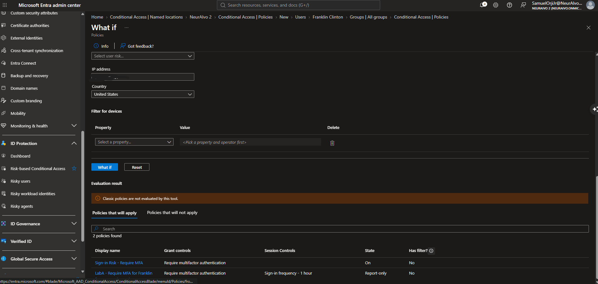
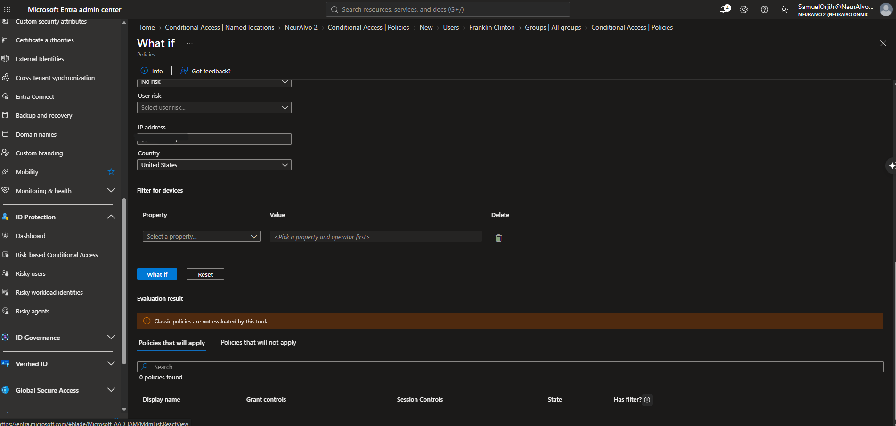

### 7. Turned the policy On and signed in as the test user
Incognito sign-in to My Apps. Franklin was forced to change his password on first sign-in, then saw an MFA registration prompt. I registered Microsoft Authenticator instead of skipping.

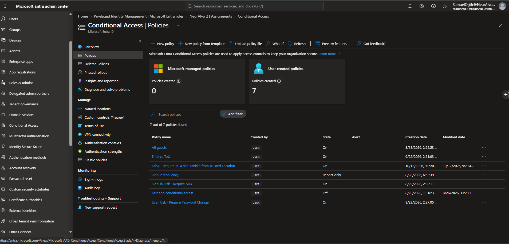
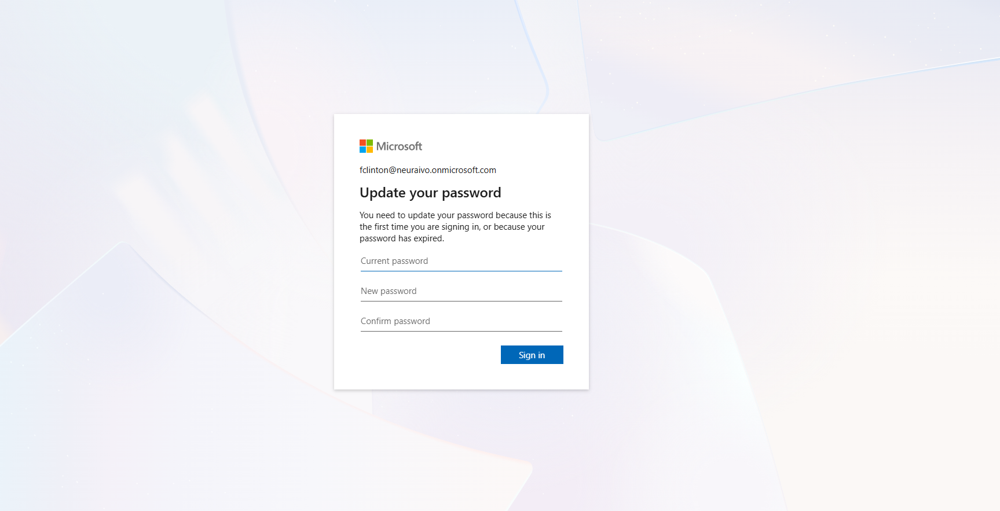
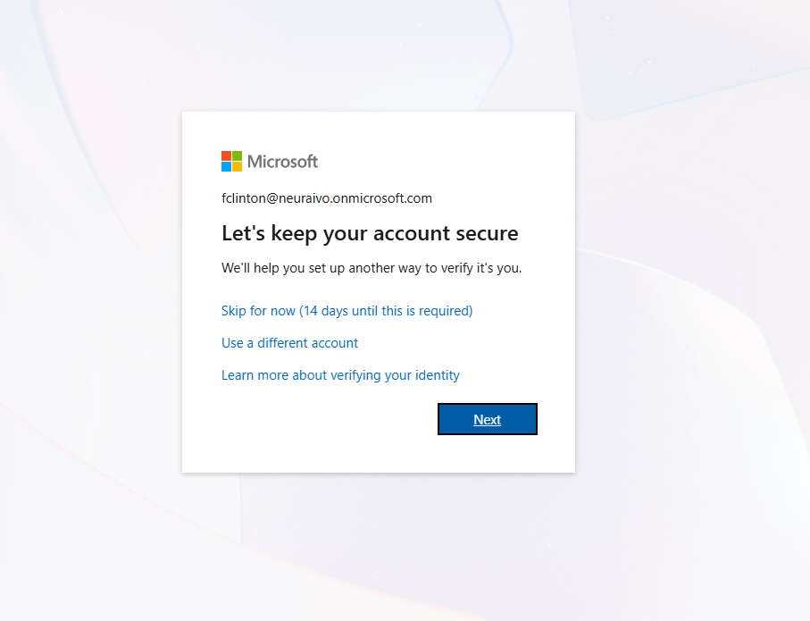
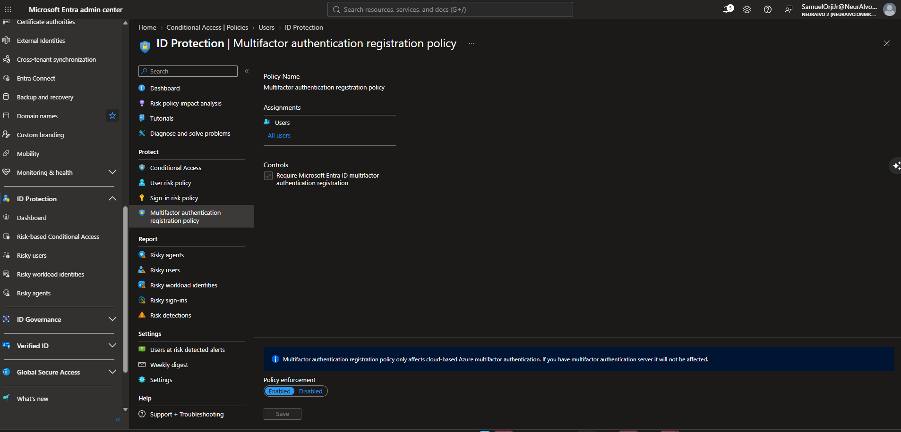
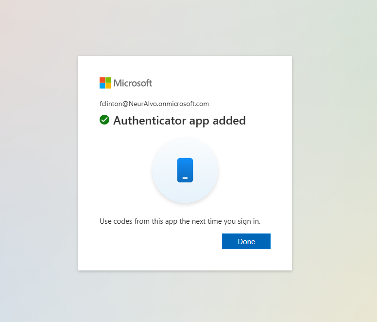

### 8. Verified the result in the sign-in log
Franklin > Sign-in logs > the sign-in > Conditional Access tab > policy details. This view shows exactly which conditions matched and which did not.

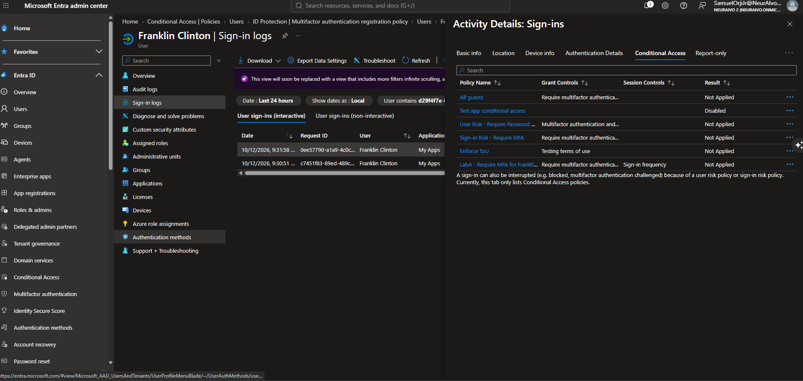
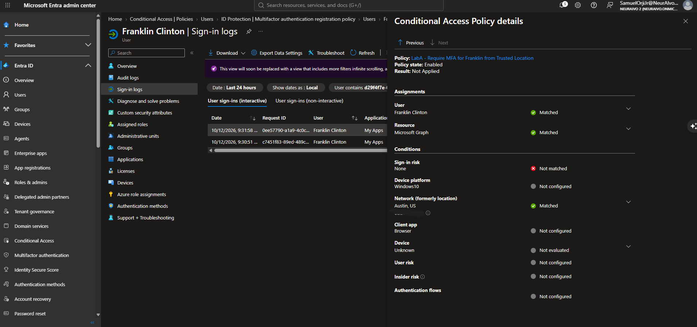

### 9. Cleaned up after testing
After documenting the results, I set the policy to **Off** so the test policy does not keep running in the tenant.

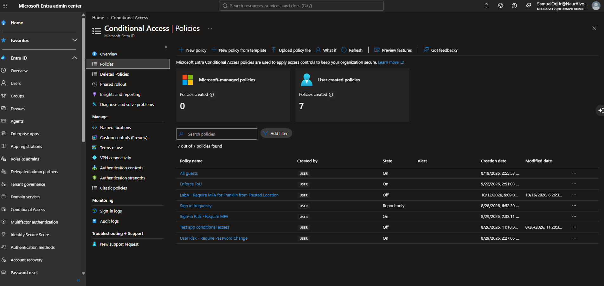

---

## What I found along the way

Five things came up mid-build that a tutorial would not have shown me. Each one is a real support scenario.

| Issue | What I found | How I handled it |
|---|---|---|
| VPN was on | Entra only sees the public egress IP. With the VPN on, that was a VPN server in another city, not my network. VPN IPs can also rotate and trigger the anonymous IP risk detection. | Turned the VPN off and used my real ISP IP. Production lesson: users behind a VPN or proxy need the VPN egress IPs in the named location. |
| Unexpected group membership | Franklin showed 1 group membership even though I assigned none. An "all company users" style group picked him up. | Removed him and noted the lesson: true dynamic group members cannot be removed by hand, only by changing the rule or the user's attributes. Always confirm the membership type. |
| One license seat | The tenant had 1 of 1 Entra ID P2 seats assigned. Unassigning a license does not lower the bill, because billing follows purchased seats. | Moved the single seat to the test user instead of buying another. |
| Surprise MFA registration prompt | No Conditional Access policy required MFA for that sign-in, yet Franklin saw "Let's keep your account secure" with a 14-day skip window. | Traced it to the ID Protection multifactor authentication registration policy (All users, Enabled). Registration and enforcement are separate controls. |
| Authenticator registered as codes | The success screen said "Use codes from this app," which usually means OATH TOTP codes, not push notifications. | Noted for verification under the user's Authentication methods. Push with number matching and OATH tokens are separate methods. |

---

## Results and proof

The policy behaved exactly as designed, and two independent sources prove it.

### What If simulation (same user, app, and IP; only risk changed)

| Simulated sign-in risk | LabA policy | Other result |
|---|---|---|
| Medium | Will apply (Report-only) | Existing "Sign-in Risk - Require MFA" policy (On) also applies |
| No risk | Will not apply | 0 policies apply |

### Real sign-in log (policy On, no-risk sign-in)

| Policy detail | Value | Result |
|---|---|---|
| User | Franklin Clinton | Matched |
| Resource | Microsoft Graph | Matched |
| Network | Trusted Office IP | Matched |
| Sign-in risk | None | Not matched |
| Device | Unknown | Not evaluated |
| **Overall** | Policy state: Enabled | **Not Applied** |

One unmatched condition under AND logic means the policy correctly did not apply. Combined with the What If result at medium risk, this proves the policy fires on a risky sign-in and stays silent on a clean one.

---

## Key concepts reinforced

**Named locations**
- Named locations take IPv4 and IPv6 ranges in CIDR notation. /32 means a single address.
- "Configure multifactor authentication trusted IPs" is the legacy per-user MFA setting. A trusted location for Conditional Access is a named location.
- Entra matches the public egress IP, so VPN and proxy users need their egress IPs listed.

**Policy logic**
- Exclude always beats include.
- Conditions combine with AND logic. Every configured condition must match.
- Every policy that applies to a user is enforced together.
- Tenant-wide policies should exclude break-glass emergency access accounts.

**Grant and session controls**
- Grant controls decide whether access is allowed and what is required first. Session controls shape what happens after sign-in.
- "Require authentication strength" cannot be combined with "Require multifactor authentication." Phishing-resistant requirements use authentication strength.

**Risk**
- Sign-in risk means this sign-in looks suspicious, and the usual fix is MFA. User risk means the account is likely compromised, and the usual fix is a secure password change. Keep them in separate policies.
- Risk conditions require Entra ID P2, and risk-based policies now live in Conditional Access.

**Testing and troubleshooting**
- Report-only evaluates and logs without enforcing. It is the answer to "assess impact without affecting users."
- What If simulates a sign-in against your policies.
- "Why wasn't the user prompted for MFA?" Check Sign-in logs, open the sign-in, then the Conditional Access tab and policy details.
- Condition states: **Not matched** (set and failed), **Not configured** (unused), **Not evaluated** (not enough information, such as an unregistered device).
- Conditional Access evaluates the backend resource (Microsoft Graph here), not only the friendly app name.

---

## Screenshot index

All public IP addresses are blurred.

| # | File | What it shows |
|---|---|---|
| 1 | LabA-step1-named-location-NoIP | Trusted Office IP, Trusted = Yes |
| 2 | LabA-step1b-new-user-created | Test user overview: Member, no roles, 1 license |
| 3 | LabA-step2-ca-policy-assignment | Users, All resources, Network set |
| 4 | LabA-step3-grant-and-session-controls-grant | Require MFA selected |
| 5 | LabA-step3-grant-and-session-controls-Session | Sign-in frequency, 1 hour |
| 6 | LabA-step4-signin-risk-condition | Sign-in risk: High and Medium |
| 7 | LabA-step5a-whatif-medium-risk-applies | Policy will apply at medium risk |
| 8 | LabA-step5b-whatif-no-risk-not-applied | 0 policies apply at no risk |
| 9 | LabA-step5c-policy-on | Policy state On |
| 10 | LabA-step5d-first-signin-password-change | Forced password change |
| 11 | LabA-step5e-mfa-registration-prompt-1 | "Let's keep your account secure," 14-day skip |
| 12 | LabA-step5f-mfa-registration | ID Protection MFA registration policy, All users |
| 13 | LabA-step5g-authenticator-registered | Authenticator app added |
| 14 | LabA-step6a-signin-log-ca-tab | All tenant policies with results |
| 15 | LabA-step6b-policy-details-why | Matched and Not matched breakdown |
| 16 | LabA-step7-policy-off | Policy set to Off after testing |

---

## About this lab series

This is the first in a series of hands-on Microsoft Entra ID labs covering Conditional Access, Privileged Identity Management, app registrations, Identity Protection, Defender for Cloud Apps, and hybrid identity. Each lab is built in a live tenant and documented with evidence.

**Samuel Orji Jr** | IAM and Cybersecurity | [github.com/SamuelOrjiJr](https://github.com/SamuelOrjiJr)
