# Lab B: Privileged Identity Management with Approval and Access Review

**Microsoft Entra ID | Privileged Identity Management | Access Reviews**
Built October 14 to 16, 2026 by Samuel Orji Jr as hands-on preparation for the SC-300 (Microsoft Identity and Access Administrator) exam.

---

## Overview

I proved the full privileged access lifecycle end to end in Microsoft Entra Privileged Identity Management (PIM). A user with zero standing access requests a privileged role, an approver signs off, the role activates for a limited window, expires on its own, and an access review removes the leftover eligibility. Every stage is backed by the PIM audit log and a CSV export, not only configuration screenshots.

**Scenario:** A Marketing Analyst occasionally needs Groups Administrator to update Marketing group membership, but should never hold that role permanently.

### Environment

| Item | Detail |
|---|---|
| Tenant | Lab tenant with Microsoft Entra ID P2 |
| Test user | Franklin Clinton, Marketing Analyst, Member account (reused from Project 3) |
| Approver and reviewer | Lab admin account |
| Role | Groups Administrator, chosen as a real privileged role that is safe to test (never Global Administrator) |

### Skills demonstrated

- Eligible vs active role assignments
- PIM role settings: activation duration, MFA on activation, justification, approval
- Just-in-time activation from the user side (My roles) and approval from the admin side
- PIM resource audit review and CSV log analysis
- Access reviews for privileged role assignments, including auto apply
- Least privilege and zero standing access design

---

## Design

| Setting | Value | Why |
|---|---|---|
| Assignment type | Eligible, not active | No standing access. The user holds nothing until they activate |
| Scope | Directory | The role applies tenant-wide when active |
| Activation maximum | 2 hours | Long enough for the task, short enough to limit exposure |
| On activation, require | Azure MFA | Proves it is really the user before elevating |
| Justification | Required | Every activation records why |
| Approval | Required, one designated approver | A second person signs off before access is granted |
| Access review | One time, eligible assignments only | Confirms the eligibility itself is still needed |

> **Production note:** This lab used a permanently eligible assignment and left "Allow permanent active assignment" on so I could focus on the activation flow. In production I would set eligible assignments to expire (for example, 6 to 12 months), turn off permanent active assignment, require MFA on active assignment, use an approver group instead of one person, and run the access review on a recurring schedule such as quarterly.

---

## Step-by-step build

### 1. Made the test user eligible for Groups Administrator
PIM > Microsoft Entra roles > Roles > Groups Administrator > Add assignments. Selected Franklin, scope Directory, assignment type **Eligible**, permanently eligible. Membership shows as Direct.

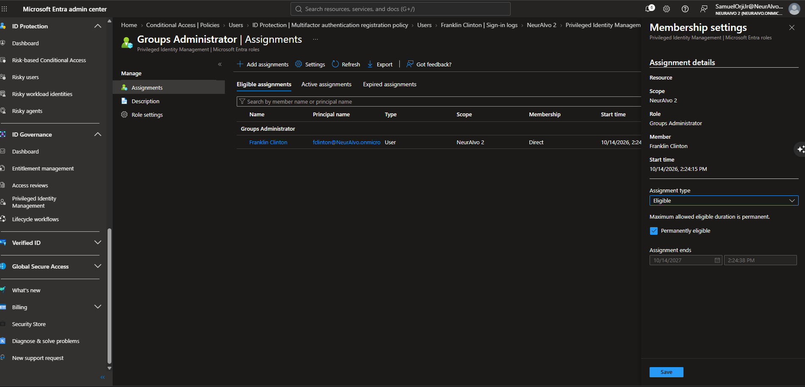

### 2. Configured the role settings
Groups Administrator > Role settings > Edit. Activation maximum 2 hours, Azure MFA on activation, justification required, approval required with a designated approver.

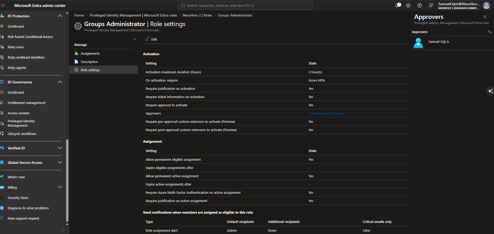

### 3. Requested activation as the user
Signed in as Franklin. PIM > My roles > Eligible assignments > Activate. Entered the reason "Need to update Marketing group membership" and submitted. The request moved to Pending approval.

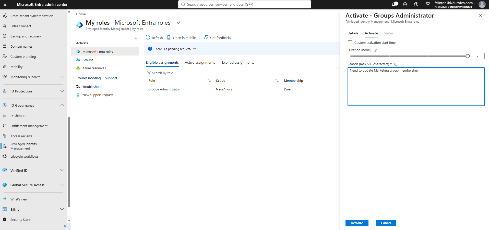
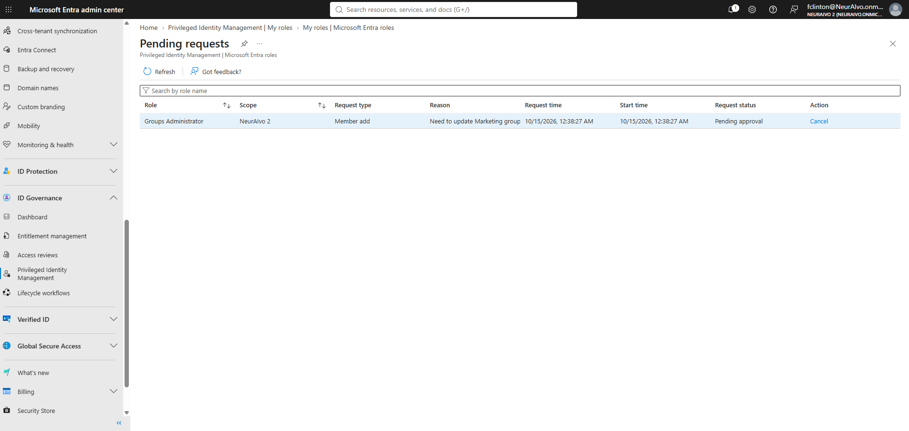

### 4. Approved the request as the admin
PIM > Approve requests. Reviewed the requestor, role, and reason, then approved with the justification "Approved for Marketing group update." Back as Franklin, the role showed as **Activated** under Active assignments with a set end time.

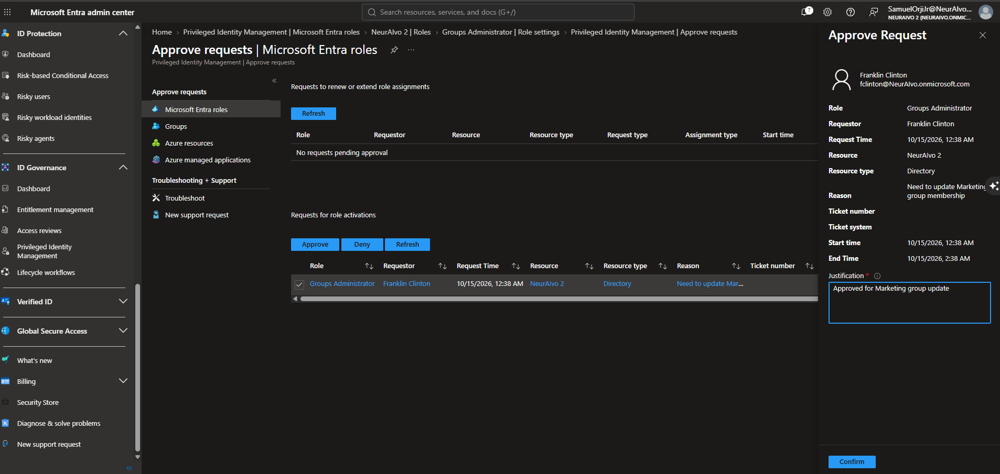
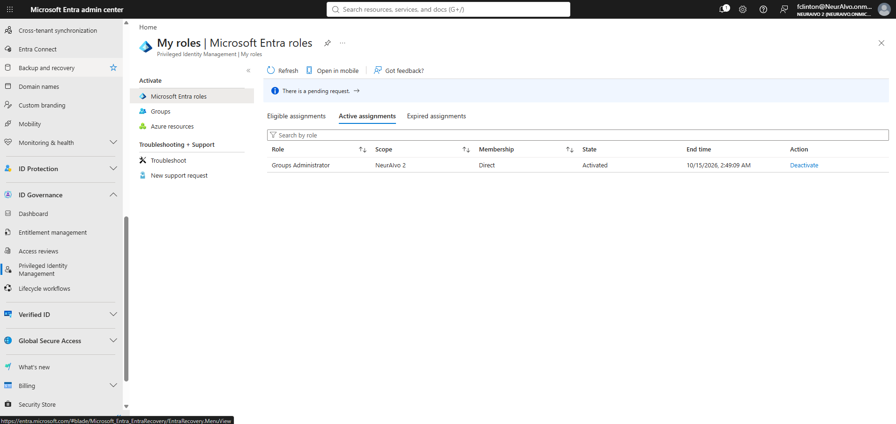

### 5. Verified the full lifecycle in the PIM audit log
PIM > Resource audit. The log shows every stage: the eligible assignment, the role settings update, the activation request, approval, activation, and finally the automatic removal when the window ended. I exported it to CSV for a closer look.

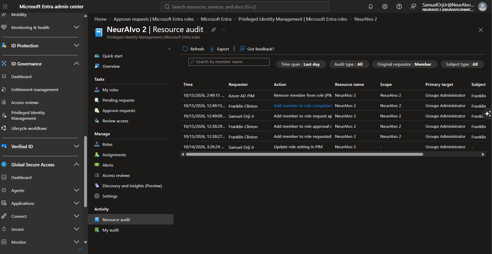
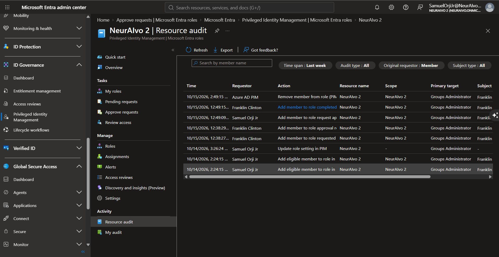

CSV export: [LabB-step5c-pim-audit-export.csv](screenshots/LabB-step5c-pim-audit-export.csv)

### 6. Ran an access review over the eligible assignment
PIM > Access reviews > New. One time review on Groups Administrator, **Eligible assignments only**, the lab admin as reviewer, auto apply results **enabled**, and "If reviewers don't respond" set to **Remove access**.

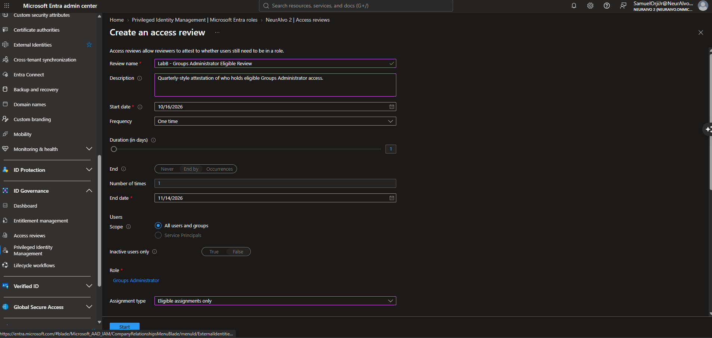
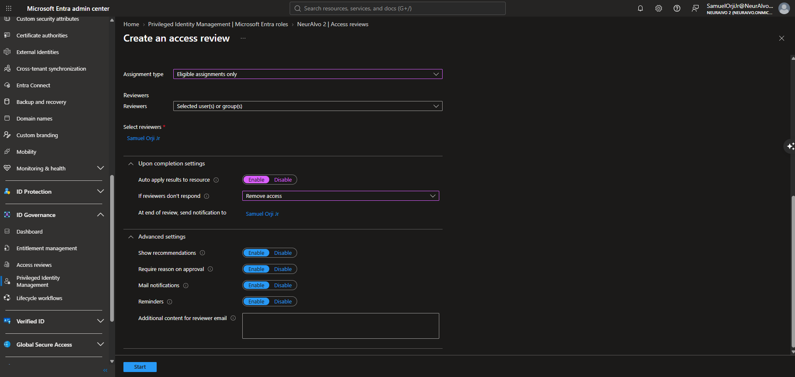

The review was created in a **Not started** state. It moved to **Active** before it showed up for the reviewer (the Active status is visible in the review overview further down).

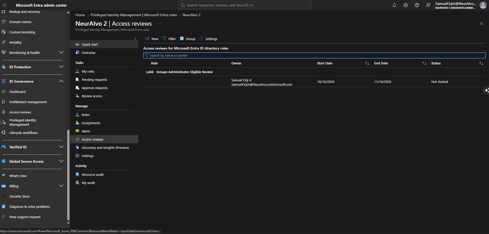

The system recommended **Approve**, because Franklin had signed in within the last 30 days.

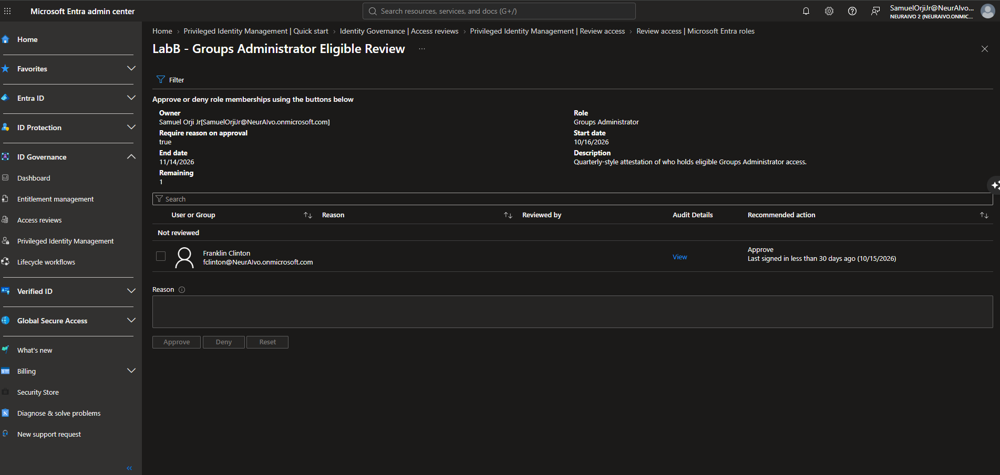

I **overrode the recommendation and denied** with the reason "Marketing group task complete, standing eligibility no longer required."

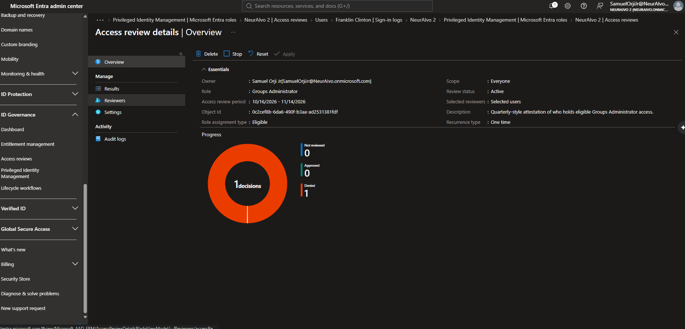
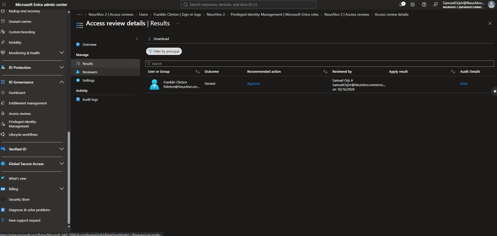

The results applied automatically. The Results page shows Applied by **Access Reviews** with an apply result of **Success: Successfully removed from membership**. Franklin's My roles page now shows no eligible assignments.

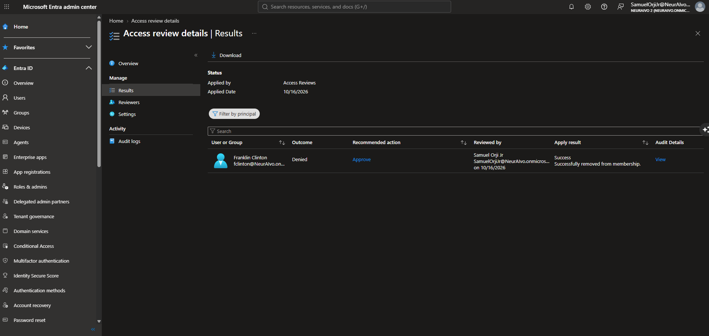
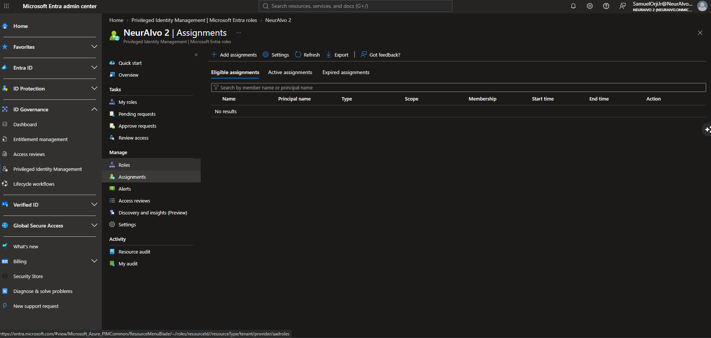

---

## What I found along the way

| Issue | What I found | How I handled it |
|---|---|---|
| Wrong activation requirement | I first selected "Microsoft Entra Conditional Access authentication context," but no authentication contexts existed in the tenant. | Switched to Azure MFA. An authentication context only works once it is created under Conditional Access and a CA policy targets it. |
| When the clock starts | The approval screen projected an end time based on the request time, but the role actually ended 2 hours after approval. | Noted that the activation window starts at approval, not at request. That matters when approvers are slow. |
| Who removed the role | The final "Remove member from role" entry was performed by **Azure AD PIM**, not an admin. | Confirmed expiration is enforced by the system itself, which is the point of just-in-time access. |
| Review not visible yet | Right after creation, the review showed as Not started and did not appear in the reviewer's queue. | Waited for it to move to Active. A review has to be active before reviewers can act on it. |
| Recommendation vs judgment | The system recommended Approve because of recent sign-in activity. | Denied anyway, since the business need was over. Recommendations are advisory and based on sign-in activity, not on whether the access is still needed. |
| Decision vs removal | Recording a Deny does not remove access by itself. The manual Apply button stayed grayed out. | Auto apply enforced the result. Without auto apply, someone has to click Apply. |

---

## Results and proof

### PIM audit log (CSV export)

| Time (UTC) | Actor | Action | Reason |
|---|---|---|---|
| Oct 14, 19:24 | Lab admin | CreateRequestPermanentEligibleRole, AssignPermanentEligibleRole | |
| Oct 14, 20:26 | Lab admin | UpdatePolicy | Max activation 2 hours, MFA on activation, approval enabled |
| Oct 15, 05:38 | Franklin Clinton | CreateRequestRoleActivation, RequestApprovalRoleActivation | Need to update Marketing group membership |
| Oct 15, 05:49 | Lab admin | ApproveRoleActivation | Approved for Marketing group update |
| Oct 15, 05:49 | Franklin Clinton | ActivateRole | Need to update Marketing group membership |
| Oct 15, 07:49 | Azure AD PIM | RemoveActivatedRole | |

What the export shows that the portal view does not:
- **UTC timestamps**, while the portal shows local time. Worth knowing before correlating logs across systems.
- **Request and fulfillment pairs.** Each change is logged as a request and then the action that fulfilled it.
- **A shared CorrelationId** ties the approval, activation, and removal together as one event chain.
- **Both justifications** are captured in the Reason column, so the audit trail shows who asked, why, who approved, and why.
- **Activation to removal is exactly 2 hours** (05:49 to 07:49), matching the role setting and starting at approval.

### Access review outcome

| Item | Result |
|---|---|
| Recommended action | Approve (signed in within 30 days) |
| Reviewer decision | Deny, with reason recorded |
| Apply | Applied by Access Reviews on 10/16/2026, result Success |
| Final state | Eligible assignment removed, no standing or eligible access left |

---

## Key concepts reinforced

**Assignments**
- Eligible means the user must activate before using the role. Active means the role is in effect now. Both can be permanent or time-bound.
- Scope can be the directory or an administrative unit.
- The least privileged role that can manage PIM for Entra roles is **Privileged Role Administrator**.
- Users who are eligible, approvers, and reviewers need Entra ID P2 or ID Governance licensing.

**Role settings**
- Settings are split across Activation, Assignment, and Notification tabs.
- If no approver is selected, Privileged Role Administrators and Global Administrators become the default approvers. Users cannot approve their own requests.
- Approval requests expire after 24 hours if nobody acts.
- "Require ticket information" is for ITSM integration. Authentication context requires a Conditional Access authentication context and a CA policy that targets it.

**User side vs admin side**
- **My roles** is where users activate eligible roles.
- **Microsoft Entra roles > Manage** is where admins assign roles and change settings.
- **Resource audit** shows all PIM activity in the directory. **My audit** shows only your own actions.
- Audit data is retained for 30 days with P1 or P2. Send it to Log Analytics, a storage account, or an event hub through diagnostic settings to keep it longer.

**Access reviews**
- Frequency ranges from one time to annually. "Inactive users only" targets stale access cleanup.
- Reviewers can be selected users or groups, the members themselves, or managers with a fallback reviewer.
- "If reviewers don't respond" options: No change, Remove access, Approve access, or Take recommendations.
- Recommendations are advisory and based on 30 days of sign-in activity.
- Stop ends a review early. Apply enforces results when auto apply is off. Reset clears decisions. Delete removes the review.

**Emergency access**
- Break-glass accounts should be permanently assigned Global Administrator, not PIM-eligible, so they work when PIM or MFA cannot.

---

## Screenshot index

| # | File | What it shows |
|---|---|---|
| 1 | LabB-step1-eligible-assignment | Franklin eligible for Groups Administrator, Directory scope |
| 2 | LabB-step2-role-settings-approval | 2 hour activation, MFA, justification, approval, approver set |
| 3 | LabB-step3a-activation-request | Activation request with reason |
| 4 | LabB-step3b-pending-approval | Request status: Pending approval |
| 5 | LabB-step4a-approve-request | Admin approving with justification |
| 6 | LabB-step4b-franklin-active | Role activated with end time |
| 7 | LabB-step5-pim-audit-trail | Resource audit, last day |
| 8 | LabB-step5b-pim-audit-full-lifecycle | Resource audit, full lifecycle including assignment |
| 9 | LabB-step5c-pim-audit-export (CSV) | Exported audit log |
| 10 | LabB-step6a-access-review-settings1 | Review name, frequency, scope, role, assignment type |
| 11 | LabB-step6a-access-review-settings2 | Reviewer, auto apply, no-response action, advanced settings |
| 12 | LabB-step6b-review-created-not-started | Review queued as Not started |
| 13 | LabB-step6c-review-recommendation-approve | Recommended action: Approve |
| 14 | LabB-step6d-deny-decision1 | Review overview: status Active, 1 decision, Denied |
| 15 | LabB-step6d-deny-decision2 | Results: outcome Denied, reviewer and date recorded |
| 16 | LabB-step6e-results-applied | Applied by Access Reviews, Success: removed from membership |
| 17 | LabB-step6f-eligible-removed | No eligible assignments remaining |

---

## About this lab series

This lab is part of a series of hands-on Microsoft Entra ID labs covering Conditional Access, Privileged Identity Management, app registrations, Identity Protection, Defender for Cloud Apps, and hybrid identity. Each lab is built in a live tenant and documented with evidence.

**Samuel Orji Jr** | IAM and Cybersecurity | [github.com/SamuelOrjiJr](https://github.com/SamuelOrjiJr)
